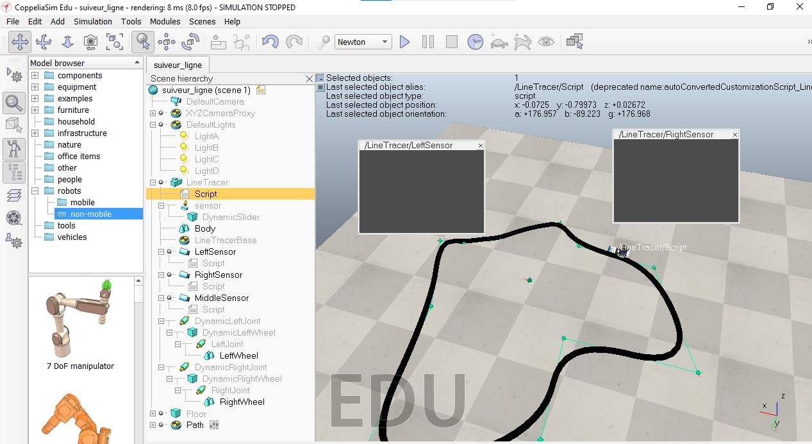

# 🤖 Autonomous Line-Following Robot — CoppeliaSim

### Mobile Robotics | SolidWorks | Lua Programming | Sensor-Based Control

**Author:** Leroy Makita Loubaki  
**Project Type:** Robotics & Mechatronics  
**Engineering Program:** ESIGELEC — DARIA

---

## 📖 1. Project Overview

This project explores the design and simulation of an autonomous line-following robot using **SolidWorks and CoppeliaSim**.

The robot is designed to follow a black path using two vision sensors and differential wheel-speed control.

The project combines three engineering areas:

- **Mechanical Design:** Robot chassis modeling using SolidWorks.
- **Robotics Simulation:** Robot behavior and sensor integration in CoppeliaSim.
- **Control Programming:** Sensor-based wheel velocity control using Lua.

## 🎯 2. Project Objectives

- Design a mobile robot chassis.
- Simulate a differential-drive robot.
- Detect a black line using vision sensors.
- Adjust wheel speeds according to sensor readings.
- Implement a simple rule-based control algorithm.
- Observe robot behavior in a simulated environment.

## 🛠️ 3. Technologies Used

| Category | Technology |
|---|---|
| Mechanical Design | SolidWorks |
| Robotics Simulation | CoppeliaSim Edu |
| Programming | Lua |
| Sensors | Left and Right Vision Sensors |
| Control | Rule-Based Differential Drive |
| Actuation | Two Driven Wheels |

## ⚙️ 4. Mechanical Design — SolidWorks

The robot chassis was initially modeled using SolidWorks.

The available rendering shows a mobile platform with two wheels, motor-support structures and space for electronic components.

### Mechanical Design Preview


**Note:** The original SolidWorks CAD files are no longer available. The mechanical design is documented using the preserved rendering.

## 🤖 5. CoppeliaSim Simulation

The line-following robot was configured in CoppeliaSim with:

- A mobile robot body.
- Two motorized wheels.
- Left and right vision sensors.
- A predefined black-line path.
- A Lua control script.

### Simulation Environment



## 🧠 6. Line-Following Control Algorithm

The robot uses a simple rule-based control strategy based on the readings of its left and right vision sensors.

### Control Logic

| Sensor Condition | Robot Action |
|---|---|
| Right sensor detects white, left detects black | Turn left |
| Left sensor detects white, right detects black | Turn right |
| Other conditions | Maintain equal wheel speeds |

### Control Parameters

The Lua implementation uses:

- Base wheel velocity: `v = 2`
- Turning correction: `dv = 2`
- Sensor intensity threshold: `0.5`

The robot adjusts its wheel velocities to influence its direction of movement.

This is a **rule-based controller**, not a PID or machine-learning controller.

## 💻 7. Lua Programming

The simulation uses CoppeliaSim's Lua scripting interface.

Key functions include:

- `sysCall_init()` — Initializes motors and sensors.
- `sysCall_actuation()` — Reads sensor data and updates wheel velocities.
- `sim.readVisionSensor()` — Accesses vision sensor readings.
- `sim.setJointTargetVelocity()` — Controls the wheel joints.
- `sysCall_sensing()` — Provides diagnostic sensor information.

The Lua implementation is available in the source-code directory.

## 🎥 8. Simulation Demonstration

A recorded demonstration illustrates the robot operating in the CoppeliaSim environment.

The demonstration video will be linked here once uploaded.

## 📁 9. Repository Structure

```text
line-following-robot-coppeliasim/
├── README.md
├── images/
│   ├── solidworks_model.png
│   └── coppeliasim_scene.jpg
├── simulation/
│   └── robot_scene.ttt
├── src/
│   └── line_follower.lua
└── videos/
    └── line_following_demo.mp4
```

*The structure above represents the intended organization. Files will be added progressively.*

## ⚠️ 10. Limitations

- The original SolidWorks CAD files are no longer available.
- The controller uses fixed speed corrections rather than continuous PID control.
- Line detection depends on configured sensor intensity thresholds.
- Performance measurements and robustness tests remain to be documented.

## 🚀 11. Future Improvements

- Implement a PID controller for smoother line tracking.
- Optimize sensor thresholds.
- Compare different line-following strategies.
- Evaluate the robot on more complex paths.
- Extend the simulation toward a physical prototype.

## 👨‍💻 12. Author

**Leroy Makita Loubaki**

Engineering Student — ESIGELEC, DARIA  
Engineering Apprentice — Constellium

Interested in Robotics, Mechatronics, Artificial Intelligence and Industrial Automation.

## 🌐 Connect With Me

[LinkedIn](https://www.linkedin.com/in/leroy-makita-loubaki-a78792290/) · [TikTok](https://www.tiktok.com/@kingtronix5) · [YouTube](https://youtube.com/@leroymakitaloubaki)

---

*Personal Robotics & Mechatronics Project.*
